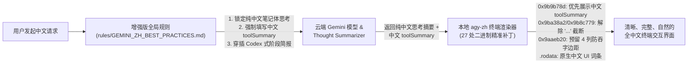

# Antigravity CLI 中文深度增强与渲染修复套件 (`antigravity-chinese`)

[](LICENSE)
[](https://github.com/IdKomorebi/antigravity-chinese)
[](https://github.com/IdKomorebi/antigravity-chinese)

> **让 Google Antigravity CLI (`agy`) 拥有媲美 OpenAI Codex CLI 与 Anthropic Claude Code 的纯正中文思考、清晰中文工具调用摘要与丝滑终端排版体验。**

---

## ✨ 为什么要做这个项目？（四大痛点与解决效果）

许多中文开发者在使用官方 **Antigravity CLI (`agy`)** 时，即使在全局规则中设置了“始终用中文思考和回答”，依然会遇到以下四个严重影响体验的问题：

| 痛点现象 | 底层根本原因（逆向拆解） | 本项目解决方案 |
| :--- | :--- | :--- |
| **1. 思考过程（Thinking）经常变成英文** | Gemini 云端开启了二级 **Thought Summarizer（推理摘要器）**。只要模型思考中夹杂了英文过渡词（如 `Let's check`）或复述英文 Prompt，云端摘要器就会将整段思考重写为第三人称英文。 | **融合 Codex 与 Claude 最佳实践规则**：强制模型采用极简中文笔记体思考，消除英文触发词，并在连续工具调用间穿插 1~2 句中文进度简报。 |
| **2. 思考过程总被单行 `...` 腰斩截断** | 客户端 `stepContent` (`0x9ba38a2`) 与 `renderCollapsedToolGroup` (`0x9b8c779`) 默认调用单行截断函数，只取最后一段并硬截断为 `...`。 | **二进制无损补丁**：绕过单行截断分支，让单步思考与折叠组 `○ 已思考 Xs (...)` 均**默认完整、多行自动折行展示**。 |
| **3. `Bash(...)` 只显示冗长生硬的命令行** | 实际上工具参数里**本来就有必填的 `toolSummary` 字段**，且二进制内已有提取函数 `toolSummaryFromMetadata` (`0x9b9ed80`)，但官方在 `Bash` 渲染分支 (`0x9b9b78d`) 漏调了该函数，硬编码读取了原始命令行！ | **51 字节原位汇编补丁**：优先调用 `toolSummaryFromMetadata` 显示简明中文目的（如 `● Bash(重新生成V6完整版文档与目录)`），无摘要时自动安全回退显示命令行。 |
| **4. 中文引用块在终端右侧吞字** | `glamour` 在计算中文弯引号（`“”`）与 `> ` 引用竖线宽度时存在东亚模糊宽度误差，超出终端右边界导致吞字。 | **折行安全边距补丁 (`0x9aaeb20`)**：保留清爽的原版英文外框标签（`Thought for Xs`、`Ran`、`Edited`），并为 Markdown 折行预留 4 列安全右边距，彻底根治吞字。 |

---

## 📸 改造前后真实终端渲染对比

### 改造前（官方原版 `agy`）
```text
○ Thought for 20m 24s (清理了临时文件。接下来，将整理基于 `original2` 的所有修改，包括对比、编辑、排版和视觉验证，准备以...)
● Ran 3 commands (python3 "reports/南网/南网分类分级文档1026/V6/scripts/toc.py" "reports/南网/南网分类分级文档1...)
● Explored 9 files (README.md, README.md, README.md, +6)
● Edited 1 file (content.py) (ctrl+o to expand)
...
▾ Thought for 17s, 478 tokens
  The observed difference in hyperlink representation between the two files is significant. It seems the second file is...
```

### 改造后（本项目：保留原生英文标签与真实命令 + 括号内中文思维链 + 带蓝色链接的中文思考简报）
```text
▸ Thought for 50s, 4.4k tokens
  我将先重新绘制路线一的二次标定效果对比图（fig5-11_r1_grade.png），将原右图的“公众可见数据类比例（4/4、3/4、1/4
  公开）”修改为规范的“公开数据可用性指标”对比。
● Ran (/usr/bin/python3 -c ' import os, json import numpy as np import matplotlib; matplotlib.use("Agg") import matplot...)
● Explored 1 file (fig5-11_r1_grade.png) (ctrl+o to expand)
  fig5-11_r1_grade.png 已重新生成并确认无误。接下来我将查看 build.py 并编写重构后的
  content.py，确保只生成单一的第五章文档（第五章_电网数据分类分级体系构建_V2.docx）及其对应的 PDF 预览文件。
○ Thought for 12s (检查构建脚本默认输出文件名配置，并更新默认路径以生成新版第五章文档。)
● Explored 1 file (build.py) (ctrl+o to expand)
  我将先更新构建脚本 build.py 的输出路径，随后编写新版 content.py 并生成 V2 的 Word 与 PDF 文档。
● Edited 2 files (build.py, content.py) (ctrl+o to expand)
  content.py 已编写完成。现在我将运行 build.py 生成 第五章_电网数据分类分级体系构建_V2.docx，并同步转换为 PDF
  版本供您直接预览。
● Ran (cd /data1/duhaocun/projects/GNN_Aggresvation/reports/南网/分类分级文档1103/V2/scripts && /u...) (ctrl+o to expand)
▸ Thought for 14s, 326 tokens
  在检查生成的 PDF 预览时，我发现两处排版细节可进一步优化：一是公式中的竖线符号（如基数符号）改用标准命令可避免转换时出现符号变形；二是将正文中无需特殊数学排版的纯小数直接写为普通文本，可使行内数字基线更加齐整。我将立即更新 content.py 并重新生成文档与 PDF。
● Edited 1 file (content.py) (ctrl+o to expand)
```

---

## 🔍 核心工作原理解析（一句话看懂）



简而言之，本项目通过 **“提示词规则锁定云端输出” + “二进制补丁修复本地终端渲染”** 双管齐下：
1. **在云端生成侧**：吸收了 **OpenAI Codex CLI** 的 `Intermediate commentary`（中间进度简报）和 **Anthropic Claude Code** 的极简中文笔记体思考规范，让模型在思考时 100% 使用纯中文笔记体，并在调用工具时自动填入简短的中文动宾短语（`toolSummary`）。
2. **在本地渲染侧**：因为 `agy` 是 Go 编译的静态 ELF 二进制文件，且其 `.rodata` 与 `.text` 段的虚拟地址与文件偏移 `1:1` 完全相等（`VA == FileOffset`），我们通过 [`scripts/patch_agy.py`](scripts/patch_agy.py) 在**不破坏任何文件结构与符号对齐**的前提下，对 4 处渲染分支机器码和 23 处只读数据词条进行了字节级精准修补。

---

## 🚀 30 秒快速开始

### 方式一：交互式一键安装（推荐）

```bash
git clone https://github.com/IdKomorebi/antigravity-chinese.git
cd antigravity-chinese
./install.sh
```

运行 `./install.sh` 后会显示清晰的中文菜单，支持 **隔离模式（默认，完全不动原版 `~/.local/bin/agy`）** 与 **全局模式（原子替换并自动备份）**。

### 方式二：命令行直接执行

```bash
# 1. 仅在仓库隔离目录 ./bin/agy-zh 下构建并运行自动化测试（零风险体验）
./install.sh --isolated

# 2. 启动隔离版中文增强 CLI（直连或通过代理）
./bin/agy-zh
./bin/agy-zh-proxy --continue

# 3. 测试满意后，一键启用全局中文增强版（自动备份原版至 ./bin/agy.orig）
./install.sh --global

# 4. 随时一键无损还原回官方原版 agy 与原有规则
./install.sh --restore
```

---

## 📂 仓库目录结构

```text
antigravity-chinese/
├── install.sh                                 # 交互式/命令行一键构建、安装与还原入口
├── README.md                                  # 项目主文档
├── LICENSE                                    # MIT 开源许可证
├── bin/                                       # 隔离环境可执行文件目录
│   └── agy-zh-proxy                           # 隔离版代理启动脚本（构建后在此生成 agy-zh 与 agy.orig）
├── rules/                                     # 提示词与全局规则目录
│   └── GEMINI_ZH_BEST_PRACTICES.md            # 融合 Codex 与 Claude 精髓的中文思考与排版规范
├── scripts/                                   # 核心补丁与验证工具链
│   ├── patch_agy.py                           # 二进制精准补丁引擎（支持 --dry-run 与 SHA256 校验）
│   ├── verify_patch.py                        # 伪终端 (PTY) 渲染回放与自动化验证脚本
│   └── switch_mode.sh                         # 状态检查、规则应用、原子切换与无损还原脚本
└── docs/                                      # 深度研究报告与技术日志
    ├── 01_根因分析与Codex_Claude机制对比.md   # 四大痛点根因拆解 + Codex/Claude 本机日志对比
    └── 02_二进制补丁原理与开发测试日志.md     # ELF 段映射、汇编级补丁对照表与 PTY 实测日志
```

---

## 🛡️ 安全性与无损还原承诺

1. **默认隔离优先**：默认在仓库内 `./bin/agy-zh` 生成增强版二进制，绝不擅自修改您系统中的 `~/.local/bin/agy`。
2. **严格特征码校验**：[`scripts/patch_agy.py`](scripts/patch_agy.py) 在写入任何字节前，会对全部 27 个补丁位点的原始机器码/字符串进行 100% 匹配校验；若版本不匹配立即安全中止。
3. **原子替换与一键还原**：全局模式采用临时文件 + `mv -f` 原子替换（避免正在运行的 `agy` 进程报错 `Text file busy`），并完整保留原版备份，随时可通过 `./install.sh --restore` 一秒恢复原状。

---

## 📖 延伸阅读

- [《01. Antigravity CLI 中文支持痛点根因分析与 Codex / Claude Code 机制深度对比》](docs/01_根因分析与Codex_Claude机制对比.md)
- [《02. Antigravity CLI 二进制补丁原理与隔离环境测试日志》](docs/02_二进制补丁原理与开发测试日志.md)
