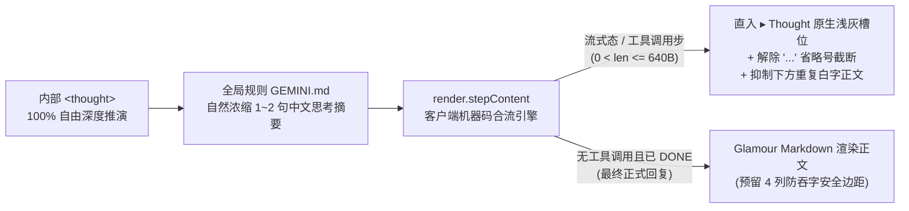

# Antigravity CLI 原生思考槽位中文汉化套件 (`antigravity-chinese`)

[](LICENSE)
[](https://github.com/IdKomorebi/antigravity-chinese)
[](https://github.com/IdKomorebi/antigravity-chinese)
[](https://github.com/IdKomorebi/antigravity-chinese)

**在不损失模型内部 `<thought>` 推理深度的前提下，通过客户端渲染器底层机器码补丁，将自然、洗练的中文思考直接合流渲染在 Antigravity CLI 原生 `▸ Thought for Xs, Y tokens` 槽位内，彻底告别云端英文摘要、单行 `...` 腰斩与右侧边缘吞字。**

---

## ✨ 核心特性

- **原生 `▸ Thought` 槽位中文合流**：直接修补客户端 `render.stepContent` 机器码，将流式与工具调用阶段的中文思考浓缩直接挂载至 `▸ Thought for Xs, Y tokens` 正下方的原生浅灰折叠槽，并自动抑制下方重复的白字正文。
- **100% 满血推理 · 通吃 Gemini & Claude**：模型内部 `<thought>` 自由深度推演零限制；无论是 Gemini / Claude 服务端 Summarized Thinking 的强制英文摘要，还是 Claude 连续工具调用时的空 `thinking`，均统一呈现为原生中文思考槽。
- **流式首字入槽 · 废除单行 `...` 腰斩**：从流式生成的第一个汉字起即稳定锚定在思考槽内，无“先吐在正文再消失”闪烁；移除 `collapsedThinkingSnippet` 与 `semanticMilestoneLines` 中的 `fitDetailText` 单行省略号截断，随终端宽度自然折行。
- **Markdown 防吞字 · 跨版本自动适配**：为 Glamour 渲染预留 4 列安全右边距，根治中文全角标点与引用块右侧吞字；内置 Go `.gopclntab` 符号自适应重定位引擎，客户端日常小版本升级无需手动改偏移；同时支持 `--ui-zh` 一键汉化 `Thought for` / `ctrl+o` 等界面标签。

---

## 📸 终端渲染效果示意

```text
▸ Thought for 13s, 365 tokens
  检测到目标文档存在活动锁文件，直接读取可能触发并发冲突，需先建立独立临时目录安全提取 XML 样式结构。
● Bash(mkdir -p "/tmp/doc_inspect") (ctrl+o to expand)

▸ Thought for 17s, 218 tokens
  定位到 stepContent 折叠分支在合流标记为 -1 时跳过了第二行摘要渲染，放宽跳转条件为 <= 0 即可让流式与完成态中文思考稳定保留在折叠槽内。
● Edit(scripts/patch_agy.py) (ctrl+o to expand)
```

---

## 🔍 工作流架构



---

## 🚀 快速开始（macOS & Linux）

### 一键全局启用（推荐）

```bash
git clone https://github.com/IdKomorebi/antigravity-chinese.git ~/.gemini/antigravity-chinese
cd ~/.gemini/antigravity-chinese
./install.sh --global
```

更新二进制后，若当前已有正在运行的 `agy` 终端进程，按 `Ctrl+C` 退出后执行 `agy -c`（或 `agy --conversation <ID>`）重新进入即可加载新代码段，历史会话中的中文思考也会立即完整呈现。

### 常用切换、扩展与还原命令

```bash
# 查看当前二进制补丁、SHA256 与全局规则状态
./install.sh --status

# 启用默认原生增强模式（保留官方英文 Thought for 标签，槽位内合流自然中文思考）
./install.sh --global

# 启用全量 UI 汉化模式（同时将 Thought for / ctrl+o 等状态标签汉化为中文）
./install.sh --ui-zh

# 仅在 ./bin/agy-zh 生成隔离测试版（不改动系统原版 agy）
./install.sh --isolated

# 运行 10 处二进制补丁 + 代码签名 + 版本健康度自动化核验
python3 scripts/verify_patch.py

# 一键无损恢复官方原版 agy 与原有规则
./install.sh --restore
```

**个人附加规则扩展**：若你有额外的个人全局规则（如本机工具路径、代码规范等），只需写入 `~/.gemini/GEMINI.local.md`，运行 `./install.sh --global` 时会自动将其与中文思考规范合并挂载，升级或切换模式永不丢失。

---

## 🪟 Windows 平台 AI 自动适配指南

本仓库开箱支持 **macOS Apple Silicon (`agy v1.5.4+`)** 与 **Linux `x86_64` (`agy v1.5.9` / `v1.5.11+`)**，并内置了 Go `.gopclntab` 函数符号自适应定位器。由于 Windows 版 `agy.exe`（PE32+ `x86_64`）与 Linux `x86_64` 采用完全一致的 Go `amd64` 内部寄存器传参 ABI，**Windows 用户无需手动逆向**——只需克隆本仓库，将下方提示词复制发给 **Antigravity CLI / Claude Code / Codex**，AI 即可直接复用本仓库的定位逻辑完成适配：

```markdown
请帮我将当前仓库 `antigravity-chinese` 的原生思考槽位中文合流补丁适配到我本机的 Windows 版 Antigravity CLI (`agy.exe`, PE32+ `x86_64`)：

1. 先阅读仓库内的 `scripts/patch_agy.py`、`scripts/verify_patch.py`、`rules/GEMINI_ZH_BEST_PRACTICES.md` 以及 `docs/原生思考槽位合流原理与跨平台移植指南.md`，重点参考 `_find_gopclntab_functions()` 与 `_auto_locate_linux_x86_64()` 中的 10 处补丁机器码结构（Go 在 Windows 与 Linux `amd64` 上使用完全相同的 Go Internal ABI 寄存器约定）。
2. 定位我本机的 `agy.exe` 路径并先备份为 `bin/agy.exe.orig`；解析 PE32+ Section Header（`.text` 与 `.rdata`），调用 `_find_gopclntab_functions()` 获取以下 5 个目标函数的相对偏移，并按 PE 节表公式 `FileOffset = RVA - VirtualAddress + PointerToRawData` 换算为文件字节偏移：
   - `glamour.WithWordWrap.func1`（折行宽度 `> 20` 时减 `4`）
   - `render.stepContent`（① 入口合流：当 `0 < Response.len <= 640` 且满足 `ToolCalls.len > 0` 或 `step.Status != 3` 时，将思考切片寄存器指向中文 `Response` 并置合流标记为 `-1`；② 折叠第二行摘要条件由 `je` 改为 `jle`；③ `verbosity == "low"` 分支由 `je` 改为 `jle`；④ 进入 `renderPlannerBody` 前的汇聚条件由 `je` 改为 `jle` 抑制下方重复正文；⑤ 流式纯思考分支的 `call fitDetailText` 替换为 5B `nop`）
   - `render.collapsedThinkingSnippet`（跳过 `\n\n` 末段截取 `jl -> jmp`，并将 `call fitDetailText` 替换为 5B `nop`）
   - `render.semanticMilestoneLines`（将两处 `call fitDetailText` 替换为 5B `nop`）
   - （可选 `--ui-zh`）在 `.rdata` 中定位 `"Thought for %s, %s tokens"` 等 5 处英文词条做 UTF-8 等长替换。
3. 反汇编核对每一处指令长度、寄存器编号与相对跳转偏移，确保所有 `BinaryPatch` 严格满足 `len(original) == len(patched)`，在 `scripts/patch_agy.py` 的 `PE_MAGIC` 分支中接入 Windows 自动定位支持，并提供 PowerShell 一键启用/还原脚本（将 `rules/GEMINI_ZH_BEST_PRACTICES.md` 部署至 `%USERPROFILE%\.gemini\config\GEMINI.md`）。
4. 先运行 `--dry-run` 与隔离构建，再执行 `python scripts/verify_patch.py` 和 `agy.exe --version` 校验 100% 通过后汇报结果。
```

---

## 📂 仓库目录结构

```text
antigravity-chinese/
├── install.sh                                       # 一键全局启用、UI 汉化、隔离构建与无损还原入口
├── README.md                                        # 项目说明、使用指南与 Windows AI 自动适配提示词
├── LICENSE                                          # MIT 开源许可证
├── rules/
│   └── GEMINI_ZH_BEST_PRACTICES.md                  # 原生思考槽位自然中文浓缩与交互指引
├── scripts/
│   ├── patch_agy.py                                 # macOS ARM64 & Linux x86_64 自适应机器码补丁引擎
│   ├── switch_mode.sh                               # 原子替换、代码签名、规则挂载与一键还原脚本
│   └── verify_patch.py                              # 补丁特征码、codesign 签名与运行健康度校验工具
└── docs/
    └── 原生思考槽位合流原理与跨平台移植指南.md      # 底层渲染逆向原理、偏移详表与跨平台移植规范
```

---

## 📖 技术文档

- [《Antigravity CLI 原生思考槽位合流原理与跨平台移植指南》](docs/原生思考槽位合流原理与跨平台移植指南.md)
