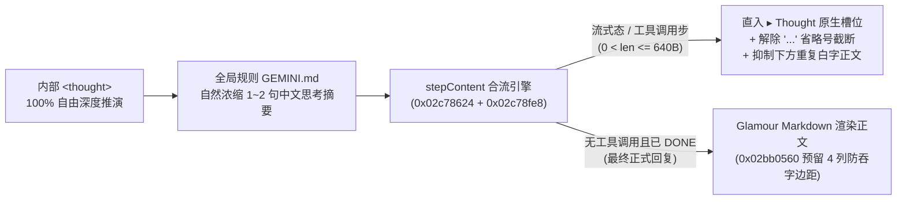

# Antigravity CLI 中文原生思考槽位合流与渲染修复套件 (`antigravity-chinese`)

[](LICENSE)
[](https://github.com/IdKomorebi/antigravity-chinese)
[](https://github.com/IdKomorebi/antigravity-chinese)

> **在不损失模型内部 `<thought>` 推理深度的前提下，将自然、洗练的中文思考直接合流渲染在 Antigravity CLI 原生 `▸ Thought for Xs, Y tokens` 槽位内，彻底告别云端英文摘要、单行 `...` 腰斩与机械“我将先…”播报。**

---

## 🆕 v2 原生思考槽位合流版与早期 v1 方案有什么区别？

早期 v1 方案（标签 `v1.5.0-legacy`）针对 Linux `x86_64` (`v1.5.0`) 采用了“压缩内部 `<thought>` 长度 + 在工具下方额外输出白字简报”的折中思路；当前主干 **v2 原生思考槽位合流版** 已在 **macOS Apple Silicon (`arm64`, `agy v1.5.4`)** 与 **Linux (`x86_64`, `agy v1.5.9`)** 双平台完成底层渲染器级重构（同时通吃 Gemini 与 Claude 全系模型）：

| 改进点 | 早期 v1 方案 (`v1.5.0-legacy`) | 当前主干（v2 跨平台原生思考槽位合流版） |
| :--- | :--- | :--- |
| **1. 中文思考渲染位置** | `▸ Thought` 仍依赖云端摘要器（含英文符号时极易变回英文），中文说明只能作为**额外白字正文**夹在工具调用下方 | **客户端二进制槽位合流（macOS `0x02c78624` / Linux `0x0a54be00`）**：主模型生成的自然中文思考浓缩**直接挂载在 `▸ Thought for Xs, Y tokens` 正下方原生浅灰槽位**，自动抑制下方重复白字正文 |
| **2. 模型推理深度与多模型兼容** | 为迁就云端摘要器，规则限制 `<thought>` 只能写“2~3 句不换行单段中文”，且 Claude 模型服务端英文摘要 / 空 `thinking` 仍会露馅 | **100% 解放 `<thought>` 完整推理能力 + 通吃 Gemini & Claude**：内部思考自由深度推演零折损；无论是 Gemini/Claude 的英文服务端摘要还是 Claude 工具步空 `thinking`，均统一渲染为原生中文思考槽 |
| **3. 流式防闪烁与防吞字** | 无槽位合流状态机 | **流式态 + 工具态双锚定**：从流式第一个汉字起直入 `▸ Thought` 槽位，并通过 `b.le` / `jle` 修复负值标记跳过第二行的底层陷阱，彻底杜绝“先吐在正文、再消失不见” |
| **4. 解除 `...` 单行腰斩** | `patch_agy.py` 仅保留了 Glamour 4 列右边距补丁，长思考仍被单行 `...` 截断 | 完整修补 `collapsedThinkingSnippet`、流式纯思考与 `semanticMilestoneLines` 的 `fitDetailText` 截断调用，`▸ Thought` 与 `○ Thought` 均**完整保留并随终端宽度自动折行** |
| **5. 思考文风与旧会话触发** | 易写成“我将先…接下来我将…”的机械第一人称动作报幕 | **100% 触发必达 + 100% 自然浓缩**：即使在几百步的历史恢复会话中也确保每步工具调用稳定输出中文思考，同时拒绝死板三段式模板，保持原生 Thought Summarizer 般自然洗练的推理摘要感 |
| **6. 跨平台与系统适配** | 仅支持 Linux `x86_64` (`v1.5.0`)，规则仅写入 `~/.gemini/GEMINI.md` | 完整支持 **macOS ARM64 Mach-O (`v1.5.4`)** 与 **Linux `x86_64` ELF (`v1.5.9`)** 10 处原生思考合流补丁（并向下兼容 `v1.5.0`），自动对齐 `agy update` 版本升级，并通过软链接 `realpath` 去重挂载 `~/.gemini/config/GEMINI.md` |

---

## 📸 真实终端渲染效果示意

```text
▸ Thought for 13s, 365 tokens
  检测到目标文档存在活动锁文件，直接读取可能触发并发冲突，需先建立独立临时目录安全提取 XML 样式结构。
● Bash(mkdir -p "/Users/haocun/...") (ctrl+o to expand)

▸ Thought for 17s, 218 tokens
  定位到 0x102c78ff0 处的 cbz 指令在合流标记 x8=-1 时跳过了第二行摘要渲染，将其扩展为 cmp x2, #0; b.le 即可让流式与完成态中文思考稳定保留在折叠槽内。
● Edit(scripts/patch_agy.py) (ctrl+o to expand)
```

---

## 🔍 核心工作流架构



---

## 🚀 快速开始

### 一键全局启用（推荐）

```bash
git clone https://github.com/IdKomorebi/antigravity-chinese.git ~/.gemini/antigravity-chinese
cd ~/.gemini/antigravity-chinese
./install.sh --global
```

> **提示**：更新二进制后，若当前已有正在运行的 `agy` 终端进程，按 `Ctrl+C` 退出后执行 `agy -c`（或 `agy --conversation <ID>`）重新进入即可加载新代码段，历史步骤中的中文思考也会立即完整呈现。

### 常用模式切换与校验命令

```bash
# 查看当前二进制补丁、SHA256 与全局规则状态
./install.sh --status

# 启用默认增强模式（保留官方英文 Thought for 标签，槽位内合流自然中文思考）
./install.sh --global

# 启用全量 UI 汉化模式（同时将 Thought for / ctrl+o 等状态标签汉化为中文）
./install.sh --ui-zh

# 仅在 ./bin/agy-zh 生成隔离测试版（完全不动 ~/.local/bin/agy）
./install.sh --isolated

# 运行 10 处二进制补丁 + macOS 代码签名 + 版本健康度自动化核验
python3 scripts/verify_patch.py

# 一键无损恢复官方原版 agy 与原有规则
./install.sh --restore
```

---

## 📂 仓库目录结构

```text
antigravity-chinese/
├── install.sh                                         # 一键构建、全局启用、UI 汉化与无损还原入口
├── README.md                                          # 项目主文档与 v1/v2 对比说明
├── LICENSE                                            # MIT 开源许可证
├── bin/                                               # 隔离构建与原版备份目录 (agy.orig / agy-zh 自动被 git 忽略)
│   └── agy-zh-proxy                                   # 可选隔离代理启动包装器
├── rules/
│   └── GEMINI_ZH_BEST_PRACTICES.md                    # 原生思考槽位自然中文浓缩与交互指引
├── scripts/
│   ├── patch_agy.py                                   # macOS ARM64 (v1.5.4) & Linux x86_64 自适应补丁引擎
│   ├── switch_mode.sh                                 # 跨平台原子替换、签名、规则软链与一键还原工具
│   └── verify_patch.py                                # 补丁特征码、codesign 签名与运行健康度核验脚本
└── docs/
    ├── 01_根因分析与Codex_Claude机制对比.md           # 早期根因拆解与 CLI 机制对比
    ├── 02_二进制补丁原理与开发测试日志.md             # Linux ELF 初版补丁记录
    └── 03_macOS_ARM64原生思考槽位合流与V1对比.md      # 本分支 macOS ARM64 汇编级原理与 v1/v2 深度对比
```

---

## 📖 延伸技术文档

- [《03. macOS ARM64 原生思考槽位合流架构（v2）与原仓库（v1 main）深度对比》](docs/03_macOS_ARM64原生思考槽位合流与V1对比.md)
- [《01. Antigravity CLI 中文支持痛点根因分析与 Codex / Claude Code 机制深度对比》](docs/01_根因分析与Codex_Claude机制对比.md)
- [《02. Antigravity CLI 二进制补丁原理与隔离环境测试日志》](docs/02_二进制补丁原理与开发测试日志.md)
